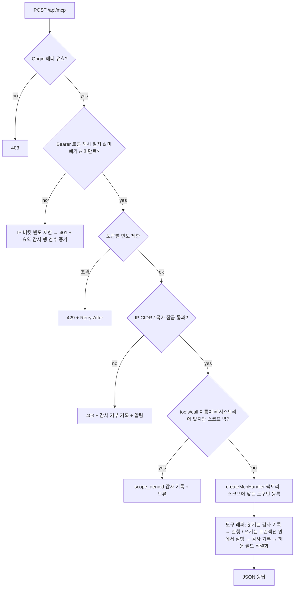
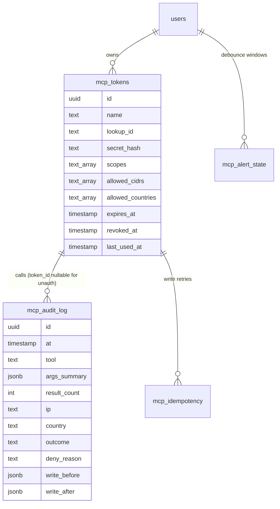

# feat: Cistory MCP 서버 (토큰 스코프·IP/국가 잠금·감사 로그)

## Summary

`/api/mcp`에 stateless Streamable HTTP MCP 엔드포인트를 연다. 소유자가 설정 화면에서 발급한 해시 저장 토큰으로만 접속한다. 요청마다 토큰 검증 → IP/국가 잠금 → 빈도 제한 → 스코프별 도구 목록 구성 → 감사 기록 순으로 처리한다. 도구가 쓸 수 있도록 지금 라우트 핸들러 안에 묶여 있는 조회 로직을 서비스 함수로 빼내고, 거래·여행 쓰기 경로에는 overview 재계산을 붙인다.

---

## Problem Frame

origin 문서의 Problem Frame을 그대로 따른다. 소유자의 자체 에이전트가 Cistory 데이터를 읽지 못해 "몇 시에 나가야 해", "ISA에 어떻게 넣어"에 답할 수 없다. 외부 에이전트에 여는 순간 이 경로가 가장 넓은 데이터 출구가 된다 (see origin: docs/brainstorms/2026-11-13-mcp-server-requirements.md).

조사 결과 구현 쪽 출발점은 이렇다.
- 기존 API 키는 `users` 위의 평문 단일 컬럼이다. 다중 토큰, 스코프, 만료 개념이 없다.
- 지출·건강·위치·커밋·포트폴리오 조회 로직 대부분이 `route.ts` 안에 인라인으로 있다.
- 웹의 정정 경로(저장 장소, 거래 PATCH, 여행 PUT·여행 아님)는 `period_snapshots`를 무효화하지 않는다.
- 앱에는 소유자 알림 채널이 없다.

---

## Requirements

origin의 R1–R35를 그대로 따른다. 계획 단계에서 아래처럼 해석을 좁히거나 보강했다.

- R25 해석: 지출 정정은 기존 `spendingOverride`의 `include`/`exclude`/`null`과 카테고리 변경만 지원한다. "수입으로 분류"는 지원하지 않는다.
- R27 보강: 쓰기 후 overview 재계산을 MCP와 웹 쓰기 경로 양쪽에 새로 붙인다. 지금 웹 UI도 재계산하지 않기 때문에, "웹과 같게"만으로는 재계산이 일어나지 않는다.
- R6 해석: 원문 알림(`rawTitle`, `rawText`)과 계좌명(`accountName`)은 모든 거래에서 sensitive-read 뒤에 둔다. 송금 상대 이름은 별도 컬럼이 없어 `merchant`에 들어 있으므로, 개인 송금으로 판정된 거래에서만 `merchant`를 가린다. 거래 `type`은 `withdrawal`/`deposit`/`cancel`뿐이어서, 송금 판정은 파서 패턴 기반의 새 함수로 한다(U7).
- R9 보강: `CF-IPCountry`가 `XX`(알 수 없음)나 `T1`(Tor)이면 국가 미판별로 보고, 국가 잠금 토큰에서 거부한다. IP를 판별할 수 없으면 IP 잠금 토큰에서 거부한다.
- R28 보강: 감사 기록에 실패하면 호출도 실패한다(fail-closed). 쓰기는 변경과 같은 트랜잭션에서, 읽기는 데이터 조회 전에 기록한다.
- R32 확정: 알림 채널은 Telegram 봇이다.

Actors, Key Flows(F1–F3), Acceptance Examples(AE1–AE5)도 origin을 따른다.

---

## Key Technical Decisions

- **SDK `@modelcontextprotocol/server` v2의 `createMcpHandler`를 직접 쓴다 (`mcp-handler`는 쓰지 않는다).** 팩토리가 요청마다 `authInfo`를 받으므로 토큰 스코프별로 도구 목록을 다르게 만들 수 있다. `mcp-handler`는 팩토리에 요청 맥락을 넘기지 않아 도구 목록을 토큰마다 바꿀 수 없다. 버전은 정확히 고정한다. v2와 spec `2026-07-28`이 나온 지 얼마 안 돼 변경이 잦다. `legacy: "stateless"`로 2025년 세대 클라이언트도 받는다.
- **JSON 응답 모드로 고정한다.** Cloudflare가 오래 열린 스트림을 끊은 이력이 있다(`src/app/api/timeline/locations/import/route.ts`). 도구 결과는 한 번에 반환한다.
- **토큰은 새 테이블에 SHA-256 해시로 저장한다.** 형식은 `cmcp_<lookupId>_<secret>`이다. `lookupId`는 고정 길이 12자 hex, `secret`은 CSPRNG 32바이트(256비트)의 hex라서 구분자 `_`와 겹치지 않는다. `lookupId`로 행을 찾고 secret 해시를 `timingSafeEqual`로 비교한다. 토큰이 없어도 조회는 항상 수행해 응답 시간으로 존재 여부가 드러나지 않게 한다(`verifyApiKey`와 같은 방식). 평문 단일 컬럼 패턴은 따르지 않는다.
- **토큰 상태는 캐시하지 않고 요청마다 다시 읽는다.** 폐기·스코프 변경은 다음 요청부터 바로 적용된다. 이미 실행 중인 읽기는 끝까지 실행된다. 쓰기는 커밋 직전에 트랜잭션 안에서 폐기 여부를 다시 확인한다.
- **클라이언트 IP와 국가는 `CF-Connecting-IP`와 `CF-IPCountry`로만 판정한다.** 소유자 확인 결과 요청 경로가 Cloudflare Tunnel이다. 기존 `clientIp()`(XFF 마지막 값)는 Tunnel 뒤에서 cloudflared 주소를 돌려줄 수 있어 MCP에서는 쓰지 않는다. 우회 경로가 없다는 것이 전제이므로, 웹 컨테이너 포트 3000이 외부에 열려 있지 않은지 운영 점검 항목으로 둔다.
- **도구 정의는 모듈 스코프에 한 번만 만들고, 요청마다 스코프에 맞는 것만 등록한다.** 핸들러 안에서도 스코프를 다시 확인한다. 도구 annotation(`readOnlyHint` 등)은 명시적으로 단다. annotation은 접근 통제 수단이 아니다.
- **민감 필드는 허용 목록(allowlist) 방식의 출력 직렬화기로 거른다.** 도구마다 내보낼 필드를 명시한다. ECG·IRN은 sensitive-read 도구로만 나간다. overview의 `OVERVIEW_HEALTH_METRICS` 방식과 같고, 테스트로 고정한다.
- **조회 로직은 서비스로 추출하고 웹 라우트도 그 서비스를 쓴다.** MCP 전용 복제 로직을 만들지 않는다. 모든 서비스 함수는 `userId`를 필수 인자로 받는다.
- **감사 로그는 인자 원문이 아니라 정규화된 요약을 저장한다.** 날짜 범위, 개수, ID는 남긴다. 자유 텍스트(검색어 등)는 길이와 해시만 남긴다. 반환 데이터는 저장하지 않는다. 쓰기는 전/후 값을 저장한다. 시각은 Drizzle로 쓴다(`DEFAULT now()` 금지, KST 9시간 함정 회피).
- **알림은 Telegram 봇으로 보내고, 묶음 상태는 DB에 둔다.** `(토큰, 사유, IP)`별 15분 창 안에서는 한 번만 보낸다. 웹 프로세스가 재시작돼도 중복되지 않는다. 일일 상한을 둔다. 전송 실패는 호출 결과에 영향을 주지 않는다.
- **쓰기에는 선택적 멱등 키를 둔다.** 에이전트가 재시도해도 저장 장소나 수동 여행이 중복 생성되지 않는다. 키는 토큰별로 24시간 보존한다.
- **응답 크기를 제한한다.** 목록 도구는 커서 페이지(기본 100건, 최대 500건)를 쓰고, 한 응답은 약 200KB를 넘지 않는다. 사진 목록 도구는 메타데이터만 준다. 썸네일은 별도 도구 `photo_thumbnails`가 MCP 이미지 콘텐츠(base64)로 주고, 한 번에 최대 3건이다(약 50KB × 3).
- **거부 경로에도 빈도 제한을 두고, 감사 행을 묶는다.** 401(토큰 미인식)은 IP 버킷, 403(잠금 위반)은 토큰 버킷으로 센다. 미인식 토큰 거부는 요청마다 행을 쓰지 않고 `(IP, 사유, 15분 창)` 요약 행의 건수를 올린다. 인식된 토큰의 거부만 요청마다 행을 쓴다.
- **스코프 위반은 SDK가 아니라 우리가 판정한다.** `tools/list`에는 허용된 도구만 노출한다. 그러나 등록되지 않은 이름으로 온 `tools/call`은 전체 도구 레지스트리와 대조해, 존재하는 도구면 `scope_denied`로 감사 기록 후 거부한다. 요청 본문을 SDK에 넘기기 전에 라우트에서 파싱해 판정한다.

---

## High-Level Technical Design

요청 처리 순서. 위에서 거부되면 아래 단계는 실행되지 않는다.



데이터 구성 (새 테이블 4개):



---

## Output Structure

```text
src/modules/mcp/
  tokens.ts              # 발급·해시·검증·회전·폐기
  gate.ts                # Origin, CF 헤더 → IP/국가, CIDR/국가 판정, 빈도 제한
  audit.ts               # 감사 기록·인자 요약·조회
  idempotency.ts         # 쓰기 멱등 키
  alerts.ts              # Telegram 전송 + 묶음
  server.ts              # createMcpHandler 팩토리, 도구 등록, 래퍼
  time.ts                # 에이전트 입력 시각/날짜 파싱, +09:00 출력
  serialize.ts           # 허용 필드 직렬화, 송금 상대 가리기
  tools/
    location.ts  places-trips.ts  spending.ts  health.ts
    work.ts  portfolio.ts  overview-search.ts  photos.ts
    rebalance.ts  travel-time.ts  writes.ts
src/app/api/mcp/route.ts
src/app/api/settings/mcp-tokens/route.ts, [id]/route.ts, audit/route.ts
src/modules/settings/components/McpTokensCard.tsx, McpAuditLog.tsx
```

---

## Implementation Units

### Phase A: 기반

### U1. 토큰·감사·멱등·알림 상태 스키마와 마이그레이션

- **Goal:** MCP 전용 테이블 4개를 추가한다.
- **Requirements:** R3, R4, R8, R28, R30, R32, R33
- **Dependencies:** 없음
- **Files:** `src/db/schema.ts`, `drizzle/0050_mcp.sql`(생성), `drizzle/meta/*`
- **Approach:**
  - 모든 테이블은 `users`에서 `ON DELETE cascade`로 지워진다.
  - `mcp_audit_log.user_id`는 nullable이다. 미인식 토큰 거부 행은 사용자가 정확히 한 명이면 그 소유자에게, 아니면 NULL로 기록한다. 설정 화면 조회는 소유자 행과 `user_id IS NULL` 행을 함께 보여 준다. `account-deletion.ts`는 `user_id IS NULL` 행도 지운다.
  - `mcp_audit_log`에는 미인식 토큰 거부를 묶는 요약 행용 `hit_count`와 `window_start`가 있다.
  - `mcp_audit_log.token_id`는 `ON DELETE set null`이다. 토큰을 지워도 기록은 남는다.
  - `mcp_idempotency`는 24시간이 지난 행을 조회에서 무시한다. 정리는 cron의 `syncAllUsers` 루프에서 지운다.
  - `lookup_id`에 unique 인덱스를 둔다.
  - 감사 로그 인덱스는 `(user_id, at)`, `(user_id, token_id, at)`이다.
  - 시각 컬럼에 `DEFAULT now()`를 쓰지 않는다.
  - `account-deletion.ts`가 새 테이블을 cascade로 지우는지 확인한다.
  - `data-usage.ts`의 카테고리에 감사 로그를 포함한다.
- **Patterns to follow:** 0048 Proton 마이그레이션의 cascade 구성, `data_usage_cache` bigint 교훈.
- **Test scenarios:**
  - Integration: 사용자 삭제 시 네 테이블 행이 모두 사라진다.
  - Integration: 토큰 삭제 시 감사 로그 행은 남고 `token_id`가 NULL이 된다.
  - Integration: 같은 `lookup_id` 삽입은 unique 위반이다.
- **Verification:** 마이그레이션이 throwaway DB에 적용되고, `scripts/migrate.ts` 경로로 재실행해도 문제없다.

### U2. 토큰 서비스 (발급·검증·회전·폐기)

- **Goal:** 해시 저장 토큰의 수명 주기를 구현한다.
- **Requirements:** R2, R3, R4, R5
- **Dependencies:** U1
- **Files:** `src/modules/mcp/tokens.ts`, `src/modules/mcp/tokens.test.ts`, `src/modules/mcp/tokens.integration.test.ts`
- **Approach:**
  - 발급은 이름, 스코프, CIDR 목록, 국가 목록, 선택적 만료를 받아 원문을 한 번만 반환한다.
  - 회전은 같은 설정으로 새 토큰을 만들고, 기존 토큰을 같은 트랜잭션에서 폐기한다.
  - 검증 결과는 `{ tokenId, userId, scopes, cidrs, countries }`이거나 거부 사유다.
  - `last_used_at`은 1분에 최대 한 번만 갱신한다.
  - 스코프 값은 `read`, `sensitive-read`, `write`이다. `sensitive-read`나 `write`만 있고 `read`가 없는 조합도 허용한다. 각 도구가 자기 스코프를 요구한다.
  - CIDR은 저장 시 정규화한다. IPv4, IPv6, `::ffff:` 매핑을 처리한다.
- **Patterns to follow:** `src/lib/api-auth.ts` `verifyApiKey`(항상 조회 + digest 비교), `src/lib/crypto.ts`는 쓰지 않는다(해시이지 암호화가 아니다).
- **Test scenarios:**
  - Happy: 발급한 원문으로 검증하면 스코프와 잠금 설정이 돌아온다.
  - Edge: 형식이 틀린 토큰, 빈 문자열, 존재하지 않는 `lookupId`는 모두 같은 거부 사유를 받는다.
  - Edge: `lookupId`는 맞고 secret이 틀린 경우도 같은 거부다.
  - Error: 폐기된 토큰과 만료된 토큰은 거부되고, 사유가 감사용으로 구분된다.
  - Happy: 회전 후 옛 토큰은 거부되고 새 토큰은 같은 설정을 가진다.
  - Edge: 잘못된 CIDR(`10.0.0.0/33`)이나 알 수 없는 국가 코드는 발급 시 검증 오류가 난다.
  - Integration: `last_used_at`이 1분 안 연속 호출에서 한 번만 바뀐다.
- **Verification:** DB에 secret 원문이 어디에도 남지 않는다.

### U3. 요청 게이트 (Origin·IP·국가·빈도)

- **Goal:** 토큰 검증 이후, 도구 실행 이전의 거부 판정을 한곳에 모은다.
- **Requirements:** R8, R9, R10, R34; F3; AE3
- **Dependencies:** U2
- **Files:** `src/modules/mcp/gate.ts`, `src/modules/mcp/gate.test.ts`
- **Approach:**
  - IP는 `CF-Connecting-IP`, 국가는 `CF-IPCountry`에서 읽는다. 헤더가 없으면 판별 불가로 둔다.
  - CIDR 판정은 순수 함수로 만든다. IPv4 매핑 IPv6는 IPv4로 정규화한다.
  - 국가 `XX`, `T1`, 빈 값은 판별 불가다.
  - 판정 규칙: 잠금 없음 → 통과. CIDR만 → IP가 범위 안이어야 함. 국가만 → 국가가 목록에 있어야 함. 둘 다 → 둘 다 만족.
  - Origin은 SDK의 `originValidationResponse`로 검사한다. Origin 헤더가 없는 비브라우저 요청은 통과한다.
  - 빈도 제한은 기존 `enforceRateLimit`에 선택 인자 `clientKey`를 추가해 쓴다(기본값은 지금처럼 `clientIp(request)`). 그대로 쓰면 XFF 마지막 값(Tunnel 뒤에서는 cloudflared 주소)이 키에 붙어 모든 비인증 요청이 한 버킷을 공유한다. MCP는 인증된 요청에 토큰 ID를, 비인증 실패에 `CF-Connecting-IP`(없으면 `"unknown"`)를 넘긴다. 초과하면 429와 `Retry-After`를 보낸다.
  - 잠금 판정은 토큰 버킷 빈도 제한 뒤에 한다. 유출된 토큰을 잠금 밖에서 반복 사용해도 버킷을 넘으면 감사 행 없이 429로 끝난다.
- **Patterns to follow:** `src/lib/api-auth.ts` `enforceRateLimit`, 웹훅 수신의 `gh-webhook-unauth` 버킷 분리.
- **Test scenarios:**
  - Covers AE3. CIDR만 있는 토큰: 국가 헤더 없음 + IP 범위 안 → 통과.
  - Covers AE3. 국가 잠금 토큰: `XX` → 거부(사유 `country_unknown`), `T1` → 거부.
  - Edge: `::ffff:192.168.0.10`이 `192.168.0.0/24`에 매칭된다.
  - Edge: IPv6 `/64` 범위 매칭, 범위 밖 IPv6 거부.
  - Edge: IP 헤더 없음 + CIDR 잠금 → 거부(`ip_unknown`), 잠금 없음 → 통과.
  - Error: 브라우저 Origin이 다른 도메인이면 403.
  - Error: 61번째 호출이 429와 `Retry-After`를 받는다.
  - Edge: 서로 다른 `CF-Connecting-IP` 두 개의 비인증 실패가 별도 버킷으로 세어진다.
- **Verification:** 모든 거부 경로가 거부 사유 코드를 돌려주고, 도구 실행에 도달하지 않는다.

### U4. 감사 로그와 텔레메트리 차단

- **Goal:** 모든 호출을 fail-closed로 기록하고, 인자와 응답이 Sentry나 로그로 새지 않게 한다.
- **Requirements:** R28, R29, R30, R31, R33, R35
- **Dependencies:** U1
- **Files:** `src/modules/mcp/audit.ts`, `src/modules/mcp/audit.test.ts`, `src/modules/mcp/audit.integration.test.ts`, `src/lib/sentry-scrub.ts`, `src/lib/telemetry-privacy.ts`, `src/lib/sentry-hooks.test.ts`
- **Approach:**
  - 인자 요약기는 도구마다 선언한 요약 규칙을 따른다. 날짜, ID, 개수는 그대로 남긴다. 자유 텍스트는 `{len, sha256 앞 8자}`만 남긴다. 민감 필드는 남기지 않는다.
  - 거부 기록(토큰 없음, 잠금 위반 등)은 토큰 ID 없이도 쓸 수 있다. 미인식 토큰 거부는 `(IP, 사유, 15분 창)` 요약 행의 `hit_count`를 올린다.
  - 쓰기의 전/후 값은 도구별 허용 필드만 저장한다. 행 전체를 넣지 않는다.
  - 읽기 호출의 결과 건수 갱신이 실패하면 데이터는 그대로 반환하고 경고 로그만 남긴다. 호출 자체의 기록은 이미 실행 전에 남았기 때문이다.
  - 기록이 실패한 거부 요청은 구조화 로그 한 줄로 대체한다. 이때도 토큰 원문은 남기지 않는다.
  - 조회 API는 토큰, 도구, 결과, 기간 필터와 커서 페이지를 지원한다.
  - Sentry URL 마커에 `/api/mcp`와 `api.telegram.org`(봇 토큰이 URL 경로에 들어간다)를 추가한다. denylist에 `authorization`, `args`, `structuredContent`를 추가한다. 세 init 모두에 적용되는지 기존 hooks 테스트로 증명한다.
  - 요청 처리 중 DB 오류는 일반 오류로 바꿔 던진다. Drizzle 오류에는 쿼리 파라미터가 들어 있다.
- **Patterns to follow:** `src/lib/sentry-scrub.ts`의 Proton 마커, `src/modules/search` 라우트의 일반 오류 재던지기.
- **Test scenarios:**
  - Happy: 읽기 호출은 도구 이름, 요약, 반환 건수, IP, 국가, `ok`를 남긴다.
  - Edge: 검색어 `"배달 민족"`은 원문 없이 길이와 해시로만 남는다.
  - Edge: 10KB짜리 인자는 요약 상한으로 잘린다.
  - Error: 감사 insert가 실패하면 읽기 도구는 데이터 없이 오류를 돌려준다.
  - Integration: 쓰기의 감사 insert가 실패하면 쓰기도 롤백된다.
  - Integration: 감사 `at`은 UTC wall time으로 저장되고, KST 조회 필터에서 9시간 밀리지 않는다.
  - Integration: 같은 IP의 미인식 토큰 거부 100건이 15분 창 안에서 요약 행 하나(`hit_count` 100)로 남는다.
  - Integration: Telegram 전송 실패 시 Sentry 이벤트와 로그에 봇 토큰이 포함된 URL이 없다.
  - Integration: Sentry 이벤트에 `/api/mcp` 요청의 Authorization 헤더와 도구 인자가 없다(실제 SDK + 캡처 transport).
- **Verification:** 감사 로그를 통째로 덤프해도 토큰 원문, 검색어 원문, 민감 필드 값이 나오지 않는다.

### U5. MCP 엔드포인트와 도구 프레임워크

- **Goal:** 라우트, 서버 팩토리, 도구 래퍼, 시각 처리를 만든다.
- **Requirements:** R1, R2, R5, R7, R20, R34; AE2
- **Dependencies:** U2, U3, U4
- **Files:** `package.json`(`@modelcontextprotocol/server` 고정), `src/app/api/mcp/route.ts`, `src/modules/mcp/server.ts`, `src/modules/mcp/time.ts`, `src/modules/mcp/serialize.ts`, 각 `*.test.ts`, `src/app/api/mcp/route.test.ts`
- **Approach:**
  - 라우트는 Node runtime, `force-dynamic`이다. POST만 처리하고 GET·DELETE는 405를 돌려준다. 응답 헤더는 `Cache-Control: private, no-store`다. 요청 본문은 64KB로 제한한다.
  - 도구 정의 형식: `{ name, scope, annotations, inputSchema(z.object), outputSchema, summarizeArgs, run(ctx, input) }`.
  - 읽기 도구 래퍼 순서: 스코프 재확인 → 감사 기록 → `run` → 허용 필드 직렬화 → 결과 건수 갱신.
  - 쓰기 도구는 실행 전에 감사를 쓰지 않는다. U9의 트랜잭션 안에서 변경 후 전/후 값과 함께 기록한다.
  - 라우트는 SDK에 넘기기 전에 JSON-RPC 본문을 파싱한다. `tools/call`의 이름이 전체 레지스트리에 있는데 토큰 스코프 밖이면 `scope_denied`를 기록하고 JSON-RPC 오류로 응답한다. 레지스트리에 없는 이름은 SDK의 Unknown tool에 맡긴다.
  - 비즈니스 오류는 `isError: true`와 한국어 메시지로 돌려준다.
  - 시각 입력 규칙: 오프셋이 있는 ISO 시각만 받는다. 오프셋이 없는 시각은 거부한다. 날짜만 오면 KST 날짜로 보고 `parseDateLocal`로 파싱한다. 출력 시각은 모두 `+09:00` 오프셋을 붙인다. 기간 범위는 366일로 제한한다.
  - `src/app/api/_routes-import.test.ts`가 새 라우트를 import할 수 있어야 한다.
- **Technical design:** (방향 제시용)

  ```text
  handler(req):
    gateOrigin(req) → verifyToken(req) → gateLock(token, cfHeaders) → rateLimit(token)
    return mcp.fetch(req, { authInfo: { token: "<redacted>", clientId: tokenId, scopes, extra: { userId, ip, country } } })
  factory({ authInfo }): server = new McpServer(); for tool in TOOLS where scopes ⊇ tool.scope: register(wrap(tool))
  ```
- **Patterns to follow:** `src/lib/api-handler.ts`의 오류 응답 형식, `src/modules/search/input.ts`의 기간 상한.
- **Test scenarios:**
  - Covers AE2. read 토큰의 `tools/list`에 쓰기 도구가 없다. 쓰기 도구를 직접 호출하면 JSON-RPC 오류가 나고, 감사에 `scope_denied`로 남는다. 레지스트리에 없는 이름은 Unknown tool이고 `scope_denied`가 아니다.
  - Happy: write 스코프 토큰의 목록에 쓰기 도구가 있고, 순서가 결정적이다.
  - Edge: `2026-11-13`은 KST 하루, `2026-11-13T09:00:00Z`는 KST 18:00로 해석된다.
  - Error: `2026-11-13T09:00:00`(오프셋 없음)은 `isError`로 거부된다.
  - Error: 367일 범위는 거부된다.
  - Error: GET은 405, 64KB 초과 본문은 413이다.
  - Integration: 실제 SDK 클라이언트로 `initialize` → `tools/list` → `tools/call`이 JSON 응답으로 끝난다(DB는 목).
- **Verification:** 잠금, 빈도, 스코프의 모든 거부 경로가 라우트 테스트로 고정된다.

### Phase B: 조회

### U6. 조회 로직 서비스 추출

- **Goal:** 라우트 안의 인라인 조회 로직을 `userId`를 받는 서비스 함수로 옮기고, 웹 라우트가 그 함수를 호출하게 한다.
- **Requirements:** R11–R17 (선행 작업)
- **Dependencies:** 없음 (U1–U5와 병렬 가능)
- **Files:**
  - 위치: `src/modules/location/queries.ts` (최신 포인트, 기간 방문·이동·원시 포인트, 현재 탑승 판정 — `src/app/api/timeline/locations/route.ts`, `/stay-points`, `/tracks` GET, `/current-activity`에서 추출)
  - 저장 장소: `src/modules/location/saved-places.ts` (`src/app/api/saved-places/route.ts`, `[id]/route.ts`에서 추출)
  - 지출: `src/modules/spending/service.ts`에 기간 조회 추가 (`src/app/api/spending/route.ts`에서 추출)
  - 건강: `src/modules/health/summary.ts` (`src/app/api/fitbit/summary/route.ts`에서 추출하고 기간 인자를 추가)
  - 작업: `src/modules/timeline/work-queries.ts` (`src/app/api/timeline/route.ts`, `/coding-stats`, `/coding-sessions`에서 추출)
  - 포트폴리오: `src/modules/portfolio/queries.ts` (`summary`, `returns`, `targets` 라우트에서 추출하고 `RETURNS_EPOCH`를 모듈로 옮김. `scripts/verify-returns.ts`의 복제본도 이 값을 import)
  - 각 추출 모듈의 `*.test.ts`
- **Approach:** 동작을 바꾸지 않는 이동이다. 라우트는 인증, 파라미터 파싱, 응답 직렬화만 남긴다. 건강 요약의 기간 인자는 기본값을 현재 30일로 두어 웹 동작을 유지한다.
- **Execution note:** 추출 전에 대상 라우트의 현재 응답을 고정하는 특성(characterization) 테스트부터 쓴다. 기존 `route.test.ts`가 있으면 그것을 쓴다.
- **Patterns to follow:** `src/modules/travel/service.ts` `TravelService`, `src/modules/search/service.ts` `searchRecords(db, userId, input)`.
- **Test scenarios:**
  - Happy: 각 웹 라우트의 응답 형태가 추출 전과 같다(특성 테스트).
  - Edge: 다른 `userId`의 행이 결과에 섞이지 않는다(목 DB의 조건 검사로 확인).
  - Edge: 건강 요약에 기간 인자를 주지 않으면 30일, 주면 그 기간을 쓴다.
- **Verification:** `yarn test`와 브라우저 회귀 테스트가 그대로 통과한다.

### U7. 조회 도구

- **Goal:** read와 sensitive-read 조회 도구를 등록한다.
- **Requirements:** R6, R11–R20; AE1; F2
- **Dependencies:** U5, U6
- **Files:** `src/modules/mcp/tools/{location,places-trips,spending,health,work,portfolio,overview-search,photos}.ts`와 각 `*.test.ts`, `src/modules/mcp/serialize.test.ts`, `src/modules/transaction/parser.ts`(`isPersonalTransfer` 노출), `src/modules/transaction/parser.test.ts`
- **Approach:**
  - `current_location`: 탐지를 실행하지 않는 순수 조회다. 최신 비이상 포인트(시각, 정확도, 경과 분)와, 그 좌표 반경 안의 가장 가까운 저장 장소(메모리 계산)를 준다. 마지막으로 저장된 방문은 종료 시각과 `visitDataThrough`를 함께 준다. 오늘 방문과 지하철 매칭은 대시보드나 다음 날 파이프라인이 만들기 때문이다. 지하철은 "마지막 처리된 탑승"으로만, 시각과 함께 표시한다.
  - `location_history`: 방문, 이동, 지하철 이용을 기간으로 조회한다. 원시 포인트는 별도 도구 `gps_points`로 두고 커서 페이지를 쓴다.
  - `saved_places`, `trips`(목록), `trip_detail`.
  - `spending`: 카테고리 합계와 건별 거래를 커서 페이지로 준다. `spending_forecast`는 월말 예측이다.
  - `health`: 기간 요약과 일별 값. 지표는 허용 목록으로 제한한다. `health_rhythm`(ECG·IRN)은 sensitive-read 전용이다.
  - `work`: 커밋 + AI 요약 + 코딩 시간.
  - `portfolio`: 계좌, 보유 종목, 목표 비중, TWR. 계좌번호(`cano`, `acntPrdtCd`)는 sensitive-read에서만 보인다.
  - `overview`: 스냅샷과 내러티브를 읽기만 한다. 재계산은 요청하지 않는다. `pending`이면 그 상태를 그대로 알린다.
  - `search`: `parseSearchInput`과 같은 규칙.
  - `photos`: `detailsSyncedAt IS NOT NULL`인 사진의 메타데이터만 준다. `photo_thumbnails`는 같은 노출 규칙으로 썸네일을 MCP 이미지 콘텐츠로 주며, 한 번에 최대 3건이다.
  - 직렬화기 규칙: sensitive-read가 없으면 민감 필드를 빼거나 `"•••"`로 가린다.
    - 모든 거래: `rawTitle`, `rawText`는 빼고 `accountName`은 가린다.
    - 개인 송금으로 판정된 거래: `merchant`도 가린다. 카드 결제 가맹점은 그대로 둔다.
    - 판정은 `src/modules/transaction/parser.ts`에 새로 노출하는 순수 함수 `isPersonalTransfer(row)`로 한다. 파서의 송금 받음, 자동이체, `→ 내 … 통장` 패턴을 `rawTitle`/`rawText`에서 인식하고 `isSelfTransfer`와 OR로 묶는다.
    - 앱 키와 토큰 컬럼은 스코프와 무관하게 절대 직렬화되지 않는다.
- **Patterns to follow:** overview의 `OVERVIEW_HEALTH_METRICS` 허용 목록 테스트, `src/modules/proton/repository.ts` `photoIsExposed`.
- **Test scenarios:**
  - Covers AE1. read 토큰: 카드 결제의 가맹점은 보이고, 송금 거래의 상대 이름은 가려진다. 모든 거래의 계좌명은 가려지고 `rawTitle`/`rawText`는 빠진다. sensitive-read 토큰에서는 모두 보인다.
  - Happy: `isPersonalTransfer`가 Toss 송금 받음, 자동이체, 내 통장 이체 픽스처를 송금으로, 카드 결제와 요금 납부를 비송금으로 판정한다.
  - Edge: 사진 썸네일 4건을 요청하면 3건만 주고 나머지는 다음 호출로 안내한다.
  - Happy: `current_location`이 최신 포인트 시각을 `+09:00`로 돌려주고 경과 분을 계산한다.
  - Edge: 위치 기록이 하나도 없으면 "기록 없음"을 돌려주고 좌표를 지어내지 않는다.
  - Edge: `gps_points` 커서로 두 페이지를 이어 받으면 중복도 누락도 없다. 페이지 크기 상한 500이 지켜진다.
  - Error: read 토큰으로 `health_rhythm`을 호출하면 거부된다. 다른 건강 도구 응답에 `ecg`/`irn` 지표가 없다(허용 목록 테스트).
  - Edge: `appKeyEnc`/`accessToken`은 sensitive-read 토큰에서도 응답에 없다.
  - Edge: NSFW 검사를 통과하지 않은 사진(`detailsSyncedAt` NULL)은 나오지 않는다.
  - Integration: `overview` 도구가 `pending` 스냅샷을 `stale` 표시와 함께 돌려주고, 재계산 큐에 아무것도 넣지 않는다.
- **Verification:** 도구마다 허용 필드 목록이 코드에 명시되고, 응답 스냅샷 테스트로 고정된다.

### U8. 계산 도구: 납입 리밸런싱, 개인 소요시간

- **Goal:** Cistory만 할 수 있는 두 계산을 도구로 만든다.
- **Requirements:** R21, R22, R23; F1, F2; AE4
- **Dependencies:** U5, U6
- **Files:** `src/modules/portfolio/rebalance.ts`, `src/modules/portfolio/rebalance.test.ts`, `src/modules/location/travel-time.ts`, `src/modules/location/travel-time.test.ts`, `src/modules/location/travel-time.integration.test.ts`, `src/modules/mcp/tools/{rebalance,travel-time}.ts`, `scripts/calibrate-travel-time-radius.ts`
- **Approach:**
  - 리밸런싱은 순수 함수다. 입력은 현재 평가액, 목표 비중, 최근 가격, 납입 금액, 정수 주식 제약이다.
    - 매도 없이 목표 대비 부족분이 큰 종목부터 채운다. 남는 현금은 잔액으로 보고한다.
    - 목표 비중의 합이 100%가 아니면 오류를 돌려준다.
    - 결과에는 종목별 매수 금액·수량, 납입 후 예상 비중, 기준 스냅샷 날짜를 준다.
  - 소요시간은 출발·도착을 좌표나 저장 장소 ID로 받는다.
    - `tracks`에는 출발·도착 좌표가 없다. 출발지는 `end_time`이 `track.start_time` 직전(허용 오차 안)인 방문의 중심 좌표, 도착지는 `start_time`이 `track.end_time` 직후인 방문의 중심 좌표로 정한다. 인접 방문이 없는 track은 제외한다.
    - 그 출발·도착 좌표가 요청 지점의 반경 안에 드는 기록을 고르고, 지배 수단별로 묶는다.
    - 조회 범위는 기본 최근 365일로 제한한다.
    - 180초 이상 중간 정차로 한 이동이 track 두 개로 쪼개질 수 있다. 보정 스크립트에서 그 빈도를 함께 측정한다.
    - 수단별로 횟수, 중앙값, p80, 주 이용 노선(`subway_trip_matches`)을 준다.
    - 표본이 최소 개수 미만이면 백분위 대신 개별 소요시간 목록만 준다.
    - 결과에 `dataThrough`(`location_processing_days` 기준 마지막 완료일)를 넣는다.
    - 시간대 필터는 KST 시각 범위다(자정을 넘기는 경우 포함).
  - 반경과 최소 표본 수는 감으로 정하지 않는다. 보정 스크립트로 실측한다(읽기 전용, 같은 출발·도착 쌍의 재현율과 오매칭 비율을 본다). 결정 전 임시값은 반경 300m, 최소 표본 3건이다.
- **Patterns to follow:** `scripts/calibrate-mode-vs-health.ts`(읽기 전용 보정, 학습/검증 분리), `src/db/sql.ts` `localDaySql`/`timestampParam`, `usage.ts`의 세션 순서.
- **Test scenarios:**
  - Covers F2. 목표 60/40, 현재 70/30, 100만원 납입: 40% 종목에 우선 배분하고, 정수 주식 제약 후 잔액과 납입 후 예상 비중을 보고한다.
  - Edge: 이미 목표 비중과 같으면 목표 비율대로 나눠 배분한다.
  - Error: 목표 합계 95%면 오류가 난다. 가격이 0이거나 없는 종목이 있으면 그 종목을 제외하고 경고를 준다.
  - Covers AE4. 지하철 40건, 도보 0건 → 지하철 통계만 나오고 도보는 "기록 없음"이다.
  - Covers F1. 집→강남 기록 5건(30, 35, 38, 40, 47분) → 중앙값 38, p80 41.4가 나온다(선형 보간, R-7).
  - Edge: 인접 방문이 없는 track은 집계에서 빠진다.
  - Edge: 표본 2건이면 백분위 없이 개별 값만 준다. 기록이 0건이면 "기록 없음"이고 추정치는 없다.
  - Edge: 시간대 22–3시 필터가 자정을 넘는 이동을 포함한다.
  - Integration: `tracks.start_time`이 UTC wall time이라는 전제로 KST 시간대 필터가 9시간 밀리지 않는다(TZ=Asia/Seoul 컨테이너).
- **Verification:** 보정 스크립트 결과로 반경과 최소 표본 상수를 확정하고, 근거 수치를 상수 옆 주석에 남긴다.

### Phase C: 쓰기와 운영

### U9. 쓰기 도구와 overview 무효화

- **Goal:** 저장 장소, 지출 정정, 여행 정정 쓰기 도구를 만들고, 웹과 MCP 쓰기 경로 모두에 overview 무효화를 붙인다.
- **Requirements:** R24–R27, R30; AE5
- **Dependencies:** U5, U6
- **Files:** `src/modules/mcp/tools/writes.ts`, `src/modules/mcp/tools/writes.test.ts`, `src/modules/mcp/idempotency.ts`, `src/modules/mcp/writes.integration.test.ts`, `src/modules/location/saved-places.ts`, `src/modules/spending/service.ts`(정정 함수), `src/modules/travel/service.ts`, `src/app/api/saved-places/route.ts`, `src/app/api/saved-places/[id]/route.ts`, `src/app/api/spending/transactions/[transactionId]/route.ts`, `src/app/api/trips/route.ts`, `src/app/api/trips/[id]/route.ts`, `src/app/api/trips/[id]/not-a-trip/route.ts`
- **Approach:**
  - 쓰기 함수는 서비스 계층에 하나씩만 두고 웹과 MCP가 함께 쓴다.
  - 서비스 쓰기 함수는 선택 인자 `inTx(tx, { before, after })` 콜백을 받는다. 이 콜백은 같은 트랜잭션(`withTripWriteLock` 또는 `db.transaction`) 안에서 커밋 직전에 실행된다. 웹 라우트는 overview 무효화만 넘기고, MCP 래퍼는 토큰 재확인 + 감사 기록 + 무효화를 넘긴다.
  - 각 MCP 쓰기는 한 트랜잭션 안에서 처리한다: 변경 전 값 읽기 → 변경 → `inTx`(토큰 행을 `FOR SHARE`로 읽어 미폐기 확인 → 감사 기록(전/후) → 무효화).
  - 트랜잭션 안에서 폐기가 확인되면 롤백한다. 그 뒤 래퍼가 별도 트랜잭션으로 `denied`/`revoked_midflight` 거부 기록을 쓴다. 그 기록마저 실패하면 U4의 구조화 로그로 대체한다.
  - overview 무효화는 `invalidateRecoveredPeriods(..., { narratives: false })`를 영향받는 KST 날짜 범위에 건다.
    - 거래: 거래일 하루.
    - 여행: 여행 기간.
    - 저장 장소: 이번 범위에서는 무효화하지 않는다. overview 집계에 영향을 주는지는 Open Questions에서 확인한다.
  - 저장 장소 쓰기와 여행 쓰기는 기존 `withTripWriteLock`을 그대로 쓴다.
  - 멱등 키: 생성형 쓰기(저장 장소 추가, 수동 여행 추가)에서 `(tokenId, key)`가 같으면 첫 결과를 그대로 돌려준다.
  - 여행 아님 처리:
    - 이미 지워진 여행이면 "이미 처리됨"을 돌려준다.
    - `TripHasNoVisitsError`면 오류 코드와 한국어 메시지를 주고 아무것도 바꾸지 않는다.
    - 수동 여행(`autoDetected=false`)은 거부하고 삭제를 안내한다.
  - 이름 변경과 재분류는 선택 인자 `expectedCurrent`를 받는다. 현재 값과 다르면 충돌 오류를 준다.
- **Patterns to follow:** `src/modules/travel/not-a-trip.ts` `markTripNotATrip`, `src/modules/location/services/trip-writer.ts`, `/api/settings/transportation-reclassify`의 무효화 호출.
- **Test scenarios:**
  - Covers AE5. 여행 아님 처리: 제외 장소가 생기고, 감사 로그에 원래 여행과 생성된 제외 장소가 남고, 여행 기간의 snapshot이 pending이 된다.
  - Happy: 카테고리 변경 시 `categorySource`가 `manual`이 되고, 해당 날짜 snapshot이 pending이 된다(웹 PATCH도 동일).
  - Edge: 같은 멱등 키로 저장 장소 추가를 두 번 하면 한 행만 생긴다.
  - Edge: 이미 삭제된 여행을 여행 아님 처리하면 "이미 처리됨"이 오고, 제외 장소는 생기지 않는다.
  - Error: 방문 없는 여행 → 오류 코드와 무변경. 수동 여행 → 거부.
  - Error: `expectedCurrent` 불일치 → 충돌, 무변경.
  - Integration: 커밋 직전에 토큰이 폐기됐으면 롤백되고, 별도 트랜잭션의 거부 기록으로 `revoked_midflight`가 남는다.
  - Integration: 두 커넥션에서 쓰기와 폐기가 경합하면, 폐기 UPDATE가 `FOR SHARE` 락을 기다려 쓰기가 끝난 뒤에 적용된다.
  - Integration: 감사 insert 실패 시 변경이 롤백된다.
- **Verification:** 웹 UI 정정 후에도 overview가 다음 precompute 주기에 반영된다.

### U10. 소유자 알림 (Telegram)

- **Goal:** 잠금 위반, 폐기 토큰 사용, 스코프 위반을 묶어서 소유자에게 알린다.
- **Requirements:** R10, R32; F3
- **Dependencies:** U1, U3, U4
- **Files:** `src/modules/mcp/alerts.ts`, `src/modules/mcp/alerts.test.ts`, `src/modules/mcp/alerts.integration.test.ts`, `.env.example`
- **Approach:**
  - 환경변수는 `MCP_ALERT_TELEGRAM_BOT_TOKEN`, `MCP_ALERT_TELEGRAM_CHAT_ID`다. 없으면 알림을 끄고 경고 로그를 한 번 남긴다.
  - 묶음 처리: `mcp_alert_state`에서 `(user, tokenId?, reason, ip)` 키의 15분 창을 원자적으로 확보한 경우에만 보낸다. 창 안의 후속 건은 개수만 늘린다. 일일 상한은 50건이다.
  - 메시지는 고정된 한국어 템플릿이다: 사유, 토큰 이름, IP, 국가, 창 안 건수. 인자나 데이터는 넣지 않는다.
  - 응답 지연을 막기 위해 요청 응답 후에 보낸다. 실패해도 호출 결과에 영향이 없다.
- **Test scenarios:**
  - Happy: 첫 잠금 위반에 메시지 하나가 나간다.
  - Edge: 15분 안 같은 키 10건 → 메시지 1건, 상태 건수 10.
  - Edge: 다른 IP는 별도로 알린다. 일일 상한에 도달하면 더 보내지 않는다.
  - Error: Telegram 5xx나 네트워크 오류가 나도 호출 응답은 그대로다.
  - Integration: 동시 요청 두 건이 같은 창을 잡으면 정확히 한 건만 보낸다.
- **Verification:** 실 토큰 없이 목 fetch로 메시지 본문에 민감 값이 없음을 확인한다.

### U11. 설정 화면: 토큰 관리와 감사 로그

- **Goal:** 소유자가 토큰을 발급·회전·폐기하고 감사 로그를 보는 화면을 만든다.
- **Requirements:** R3, R4, R31
- **Dependencies:** U2, U4
- **Files:** `src/app/api/settings/mcp-tokens/route.ts`, `src/app/api/settings/mcp-tokens/[id]/route.ts`, `src/app/api/settings/mcp-tokens/audit/route.ts`, 각 `route.test.ts`, `src/modules/settings/components/McpTokensCard.tsx`, `src/modules/settings/components/McpAuditLog.tsx`, `src/modules/settings/components/SettingsForm.tsx`, `tests/browser/` 픽스처
- **Approach:**
  - 세션 인증과 same-origin을 검사한다(`withAuth`/`withValidation`).
  - 카드는 설정 화면의 "관리" 섹션에 둔다. 토큰마다 이름, 스코프, 잠금, 마지막 사용, 만료, 상태를 보여 준다.
  - 원문은 발급과 회전 직후 한 번만 보여 준다.
  - 감사 로그는 필터와 커서 페이지를 지원한다. 거부 건은 사유를 한국어로 표시한다.
  - 감사 로그 삭제(R33): 기간이나 토큰을 지정해 지운다. 세션 인증과 same-origin 검사를 거친다.
  - 쓰기 스코프와 sensitive-read를 함께 주거나 잠금 없이 발급할 때 경고를 표시한다. `0.0.0.0/0`, `::/0`은 잠금으로 인정하지 않는다.
  - 디자인 시스템 컴포넌트를 쓴다. 글리프나 이모지 상태 표시는 쓰지 않는다(`StatusBadge`).
- **Patterns to follow:** `src/modules/settings/components/OwnTracksSettings.tsx`, `panel.tsx`, `AccountRolesCard.tsx`.
- **Test scenarios:**
  - Happy: 발급 응답에만 원문이 있고, 목록 응답에는 접두부만 있다.
  - Error: 다른 오리진 POST는 403, 비로그인은 401이다.
  - Edge: 잘못된 CIDR은 400과 한국어 메시지를 받는다.
  - Browser: 390px 폭에서 토큰 카드와 감사 로그 표가 가로 스크롤 없이 표시된다.
- **Verification:** 발급 → 에이전트 호출 → 감사 로그 표시가 한 번에 이어진다.

### U12. 문서·개인정보 고지·운영 점검

- **Goal:** 외부 에이전트로 데이터가 나간다는 사실을 고지하고, 운영 전제를 문서화한다.
- **Requirements:** R35, 운영 전제
- **Dependencies:** U5, U10
- **Files:** `src/app/privacy/page.tsx`, `CLAUDE.md`, `.env.example`, `scripts/browser-server.mjs`(새 부트 파일이 있으면 복사 목록 추가)
- **Approach:**
  - `/privacy`에 MCP 토큰으로 접속한 소유자의 에이전트에게 어떤 데이터가 나가는지 적는다. 에이전트가 다른 모델 제공자로 보낼 수 있다는 점도 적는다.
  - `CLAUDE.md`에 MCP 절을 추가한다: 엔드포인트, 스코프, 잠금 헤더 전제, 감사 fail-closed, 알림 환경변수.
  - 운영 점검:
    - 웹 컨테이너 포트가 Tunnel 외 경로로 외부에 노출되지 않는지 확인한다.
    - Cloudflare zone에서 방문자 위치 헤더가 켜져 있는지 `curl`로 확인한다.
- **Test expectation:** none -- 문서와 고지 텍스트 변경
- **Verification:** 운영 점검 결과를 PR 설명에 기록한다.

---

## System-Wide Impact

- **인증 경계:** 세션 외의 두 번째 인증 수단(MCP 토큰)이 생긴다. 웹 라우트는 MCP 토큰을 받지 않는다. MCP 라우트는 세션 쿠키를 받지 않는다.
- **웹 동작 변화:** U9로 웹의 정정 경로도 overview를 무효화한다. U6 추출은 응답을 바꾸지 않는다.
- **웹 이벤트 루프:** MCP 조회는 웹 컨테이너에서 실행된다. 페이지 상한과 기간 상한(366일)으로 한 호출의 일을 제한한다. 소요시간 계산은 최근 365일 track 범위 스캔(`idx_track_user_start`)과 인접 방문 조인 후 메모리 집계로 한다. 실측에서 무거우면 별도 프로세스로 옮기는 것을 검토한다.
- **단일 레플리카 전제:** 빈도 제한은 프로세스 메모리 상태다. 웹 레플리카를 늘리기 전에 공유 저장소로 옮겨야 한다. 알림 묶음은 DB 상태라 영향이 없다.
- **데이터 사용량:** 감사 로그가 사용자별 데이터 사용량 카드에 잡힌다.

---

## Risks & Dependencies

| 위험 | 대응 |
|---|---|
| MCP SDK v2와 spec `2026-07-28`이 막 나와 API가 바뀔 수 있음 | 정확한 버전 고정. SDK 클라이언트로 왕복하는 통합 테스트를 둠 |
| 에이전트 클라이언트가 어느 프로토콜 세대를 쓰는지 모름 | `legacy: "stateless"`로 두 세대 모두 수용 |
| Tunnel 외 경로로 원본에 접근 가능하면 CF 헤더 위조 가능 | U12 운영 점검. 포트 노출이 확인되면 배포 전에 막음 |
| 조회 로직 추출 중 웹 응답 회귀 | U6 특성 테스트 우선 + 브라우저 회귀 테스트 |
| 소요시간 "같은 구간" 판정이 부정확 | 보정 스크립트로 반경과 표본 수를 실측 |
| 감사 fail-closed로 DB 장애 시 MCP 전체 불가 | 의도된 동작. 웹 대시보드는 영향 없음 |

---

## Scope Boundaries

origin의 Scope Boundaries를 그대로 따른다.
- 동기화·재계산·복구 트리거는 넣지 않는다.
- OAuth와 claude.ai 커넥터는 넣지 않는다.
- 범용 쿼리 도구와 실시간 길찾기는 넣지 않는다.
- 외부 시스템에 영향을 주는 동작(증권 주문, 원본 사진 다운로드)은 하지 않는다.
- 다중 사용자는 고려하지 않는다.

### Deferred to Follow-Up Work

- "수입으로 분류" 오버라이드: `classify()`·`bucketSql()` 변경과 `OVERVIEW_COMPUTE_VERSION` 올림이 필요하다.
- 송금 상대 이름 전용 컬럼: 지금은 거래 유형으로 판정한다.
- 감사 로그 보관 정책: 볼륨이 문제가 되면 요약 롤업이나 오래된 행 압축을 검토한다.
- 빈도 제한 공유 저장소 이전: 레플리카 확장 시.

---

## Open Questions

### Deferred to Implementation

- 저장 장소 변경이 overview 집계에 실제로 영향을 주는지: 방문 이름이 집계 시점에 결합되는지 확인하고, 영향이 있으면 무효화 범위를 정한다.
- 소요시간 반경과 최소 표본 수: U8 보정 스크립트 결과로 정한다.
- 건강 요약 추출 시 30일 고정 계산 중 기간 인자로 일반화하기 어려운 부분이 있는지.
- SDK v2 `registerTool`이 `outputSchema`를 선언한 도구의 오류 결과를 어떻게 검증하는지.

---

## Sources & Research

- 기존 키 패턴: `src/lib/api-auth.ts`(`verifyApiKey`, `enforceRateLimit`, `clientIp`), `src/lib/api-key-route.ts`
- 프라이버시 선례: `src/lib/sentry-scrub.ts`, `src/lib/telemetry-privacy.ts`, `src/lib/sentry-hooks.test.ts`, overview `OVERVIEW_HEALTH_METRICS`
- 웹훅 시크릿 비교와 비인증 버킷 분리: `docs/superpowers/specs/2026-11-09-google-health-new-features-design.md` §4
- 429 + `Retry-After` 교훈: 커밋 `dae08d5` (OwnTracks 백로그 유실)
- 무효화 함수: `src/modules/data-status/recovery.ts` `invalidateRecoveredPeriods`
- 여행 정정: `src/modules/travel/not-a-trip.ts`, `src/modules/location/services/trip-writer.ts`
- 민감 컬럼: `transactions.merchant/accountName/rawTitle/rawText`, `brokerageAccounts.cano/acntPrdtCd/appKeyEnc/appSecretEnc/accessToken`, `health_samples` `ecg`/`irn` (`src/modules/health/rhythm.ts`)
- Cloudflare가 긴 스트림을 끊는 이력: `src/app/api/timeline/locations/import/route.ts`
- MCP spec 2026-07-28 (stateless, Origin 검증, 토큰별 tools/list 허용, token passthrough 금지): https://modelcontextprotocol.io/specification/2026-07-28/basic/transports/streamable-http, https://modelcontextprotocol.io/specification/2026-07-28/server/tools, https://modelcontextprotocol.io/specification/2026-07-28/basic/security_best_practices
- SDK: `@modelcontextprotocol/server` 2.4.0 (`createMcpHandler`, `originValidationResponse`), `mcp-handler` 2.4.0(요청 맥락 미전달로 채택 안 함)
- Cloudflare 헤더: https://developers.cloudflare.com/fundamentals/reference/http-headers/
